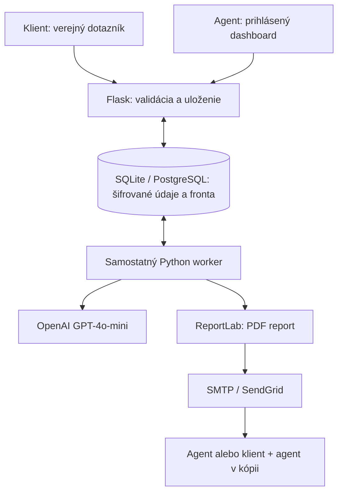

# KUBEK Finance - klientsky a agentov portál

Kompletný samostatne spustiteľný projekt v Pythone 3.12+. Flask obsluhuje verejný dotazník a interné stránky, SQLAlchemy databázu, worker spracúva AI a e-maily. Šablóny aj PDF sú po slovensky. Stav vykonaných kontrol a nasadenia je v `VERIFICATION.md`. Zdrojový balík neobsahuje skutočné klientské údaje ani API kľúče.

## 1. Štruktúra projektu

```text
kubek-finance-portal/
├── app.py                   # routy, autentifikácia, dashboard, CLI
├── config.py                # nastavenia z prostredia
├── database.py              # agenti, dopyty, verzie reportov, úlohy, audit
├── security.py              # šifrovanie, relácie, kontrola vlastníctva
├── schemas.py               # validácia klientskych dát a návrhov
├── finance.py               # DTI, pomery, anuita, refinancovanie
├── ai_analysis.py           # GPT-4o-mini a pravidlový náhradný profil
├── email_service.py         # SMTP s TLS alebo SendGrid cez HTTPS
├── pdf_service.py           # ReportLab PDF a text e-mailu
├── reporting.py             # nemenný podklad pre report
├── worker.py                # trvalá fronta úloh v SQL databáze
├── init_env.py              # vytvorenie .env so súkromnými kľúčmi
├── templates/               # klientsky formulár a interné stránky
├── static/                  # CSS a JavaScript bez externých CDN
├── assets/fonts/            # fonty s diakritikou a ich licencia
├── tests/                   # funkčné, bezpečnostné a výpočtové testy
├── examples/                # fiktívny klient a vzorový PDF report
├── .env.example
├── requirements.txt
├── requirements-dev.txt
├── Dockerfile
├── docker-compose.yml
├── start-web.sh             # inicializácia databázy a štart webu
└── README.md
```

## 2. Architektúra a tok dát



1. Správca vytvorí účet agenta cez CLI. Nie je tu verejná registrácia.
2. Agent v dashboarde skopíruje svoj náhodný odkaz `/formular/<token>`.
3. Klient odošle kontakty, údaje domácnosti, čisté príjmy, výdavky, dlhy, rezervu, ciele a poznámky. Povinné je potvrdenie informácií o spracúvaní; AI má samostatnú voliteľnú voľbu.
4. Server validuje vstupy, uloží zašifrovaný dopyt s dátumom a vytvorí úlohu `analyze` v rovnakej databázovej transakcii. Opakovaný klik nevytvára druhý dopyt.
5. Worker vykoná deterministické výpočty a podľa konfigurácie/voľby klienta AI komentár. Potom zaradí notifikáciu agentovi vrátane kompletného textového profilu a interného PDF.
6. Agent vyhľadá klienta, zmení stav dopytu a doplní vlastný návrh. Pri refinancovaní označí nahradené úvery. Server prepočíta stav pred/po.
7. Agent otvorí klientsky PDF náhľad, potvrdí kontrolu a použije tlačidlo „Odoslať sumarizáciu klientovi“.
8. Vznikne nemenný podklad s verziou návrhu. Worker z neho vytvorí PDF a odošle e-mail klientovi, agentovi v kópii. Neskoršie zmeny návrhu nemenia historický report.

### Databázové tabuľky

| Tabuľka | Úloha |
|---|---|
| `agent` | Účet, hash hesla, stav účtu, zneplatnenie relácií, hash verejného odkazu |
| `inquiry` | Priradený agent, šifrované vstupy/analýza/návrh, verzia, dátum a stav |
| `summary` | Nemenný šifrovaný podklad reportu, verzia a stav prijatia poskytovateľom |
| `job` | Trvalá fronta, počet pokusov, prenájom úlohy workerovi, bezpečný chybový kód |
| `audit_event` | Agent, typ operácie, dopyt a čas bez kopírovania klientskych údajov |

Jeden agent vidí iba vlastné dopyty, PDF, sumarizácie a úlohy. Klient nemá účet; formulár je verejný a odkaz nezobrazuje už uložené údaje.

## 3. Spustenie lokálne - Windows

Nainštalujte Python 3.12 alebo novší s voľbou „Add Python to PATH“. Rozbaľte projekt a otvorte PowerShell v priečinku projektu.

```powershell
py -3.12 -m venv .venv
.\.venv\Scripts\python.exe -m pip install -r requirements.txt
.\.venv\Scripts\python.exe init_env.py
.\.venv\Scripts\python.exe -m flask --app app:create_app init-db
.\.venv\Scripts\python.exe -m flask --app app:create_app create-agent --email agent@vasa-firma.sk --name "Meno Priezvisko"
.\.venv\Scripts\python.exe app.py
```

Pri vytváraní agenta zadáte a zopakujete vlastné heslo s najmenej 12 znakmi. Heslo sa pri písaní nezobrazuje. Nepoužívajte doslovne ukážkový e-mail, ak má agent dostávať notifikácie.

V druhom PowerShell okne v rovnakom priečinku spustite worker:

```powershell
.\.venv\Scripts\python.exe worker.py
```

Otvorte `http://127.0.0.1:5000`. Prihláste sa vytvoreným účtom. Pre klientsky formulár použite odkaz z dashboardu.

## 4. Spustenie lokálne - macOS / Linux

```bash
python3 -m venv .venv
source .venv/bin/activate
pip install -r requirements.txt
python init_env.py
flask --app app:create_app init-db
flask --app app:create_app create-agent --email agent@vasa-firma.sk --name "Meno Priezvisko"
python app.py
```

V druhom termináli:

```bash
cd kubek-finance-portal
source .venv/bin/activate
python worker.py
```

Oba procesy potrebujú rovnaké `.env`. Bez workera sa dopyt uloží, no AI a e-maily zostanú vo fronte. Lokálna adresa funguje iba na vašom počítači; pre klientov potrebujete hosting s HTTPS.

### Čo funguje bez externých účtov

Formulár, databáza, prihlásenie, dashboard, výpočty, návrhy a PDF fungujú hneď. OpenAI a e-mail sú v predvolenom nastavení vypnuté. Worker vytvorí pravidlový profil a pri e-maile viditeľný stav „Chýba konfigurácia e-mailu“; nič nepredstiera ako odoslané.

## 5. Zapnutie OpenAI

Do `.env` nastavte vlastný kľúč z OpenAI API:

```dotenv
OPENAI_API_KEY=vas_vlastny_api_kluc
OPENAI_MODEL=gpt-4o-mini
```

Reštartujte web aj worker. Pre nového klienta sa AI zavolá iba po označení voliteľnej AI voľby v dotazníku. Existujúce výpočty sú dostupné aj bez AI; po doplnení chýbajúcej konfigurácie vytvorte nový testovací dopyt. Zlyhanú úlohu možno zopakovať v detaile.

Používa sa oficiálny Python SDK, `client.chat.completions.parse`, Pydantic schéma a `store=False`. Výstup obsahuje zhrnutie, silné stránky, riziká, ďalšie kroky a chýbajúce údaje. Číselné metriky počíta Python. AI nemá nástroje, neposiela správy a neschvaľuje úvery.

Do API sa posiela len povolený zoznam finančných a domácnostných údajov; meno, kontakty, názvy bánk a voľné poznámky sa vynechávajú. Ide o minimalizáciu údajov, nie záruku anonymity. Pri chybe sú najviac tri pokusy; potom zostane výpočtový a pravidlový profil a agent dostane notifikáciu o dostupných výsledkoch.

Oficiálne zdroje: [GPT-4o-mini](https://developers.openai.com/api/docs/models/gpt-4o-mini), [Structured Outputs](https://developers.openai.com/api/docs/guides/structured-outputs).

## 6. Zapnutie e-mailov

### Možnosť A - SMTP

```dotenv
EMAIL_BACKEND=smtp
MAIL_FROM=portal@vasa-firma.sk
SMTP_HOST=smtp.vas-poskytovatel.sk
SMTP_PORT=587
SMTP_SECURITY=starttls
SMTP_USERNAME=portal@vasa-firma.sk
SMTP_PASSWORD=heslo_aplikacie_alebo_smtp_heslo
```

Pri implicitnom TLS použite port a voľbu podľa poskytovateľa, obvykle `SMTP_PORT=465` a `SMTP_SECURITY=ssl`. Nešifrované SMTP aplikácia nepodporuje. `MAIL_FROM` musí byť povolený odosielateľ; niektorí poskytovatelia vyžadujú heslo aplikácie.

### Možnosť B - SendGrid HTTPS

```dotenv
EMAIL_BACKEND=sendgrid
MAIL_FROM=portal@vasa-firma.sk
SENDGRID_API_KEY=vas_sendgrid_api_kluc
```

Overte odosielateľa/doménu v SendGrid a nastavte DNS podľa poskytovateľa. Reštartujte worker a zablokované úlohy zopakujte v detaile klienta.

E-mail agentovi ide na adresu jeho účtu. Klientska sumarizácia ide na adresu z dotazníka a agentovi v kópii. Príloha obsahuje finančné údaje; používajte adresy oprávnených príjemcov. Klientsky report obsahuje agentom schválený text; interný AI komentár sa doň automaticky nepridáva.

### Stav doručovania

| Stav | Význam |
|---|---|
| `pending` | Čaká na worker alebo na ďalší automatický pokus |
| `running` | Worker spracúva úlohu |
| `done` | Úloha bola dokončená |
| `blocked` | E-mail nemá použiteľnú konfiguráciu |
| `failed` | Pokusy sa vyčerpali; agent môže zopakovať úlohu |
| `uncertain` | Poskytovateľ možno správu prijal; stav treba overiť pred opakovaním |
| `accepted` | Poskytovateľ prijal klientsku správu; doručenie do schránky sa tým nepotvrdzuje |

Jedna verzia návrhu vytvorí iba jednu sumarizáciu. Po schválení sa posiela nemenná verzia. SMTP ani SendGrid tu neposkytujú transakciu so SQL databázou: pri strate spojenia alebo páde workera môže byť výsledok neznámy. Preto sa neisté e-maily automaticky neopakujú. Pri manuálnom opakovaní agent potvrdí možnú duplicitu. Prípadné bounces/doručenie sleduje v poskytovateľovi; webhook na doručenie nie je súčasťou tejto verzie.

## 7. Výpočty a správne pomenovanie výsledkov

Vstupy sú deklarované údaje domácnosti, nie bankou uznaný príjem. Príjem zo s.r.o. je osobný čistý príjem, nie obrat. Bežné výdavky nezahŕňajú splátky zapísané osobitne. Peniaze sa rátajú cez `Decimal`; na zobrazenie sa zaokrúhľujú na centy.

```text
Mesačný čistý príjem = TPP + živnosť + osobný príjem zo s.r.o. + ostatné príjmy
DTI = čerpané dlhy / (12 × mesačný čistý príjem)
DTI s limitmi = (čerpané dlhy + 20 % nevyužitých kartových limitov) / ročný príjem
Jednoduchý pomer splátok = mesačné splátky / mesačný čistý príjem × 100
Disponibilný zostatok = čistý príjem - bežné výdavky - splátky
Orientačný DSTI = agentom zadané posudzované splátky / (príjem - zadané ŽM) × 100
```

Pri nulovom príjme sa pomery neuvádzajú. DSTI zostáva neurčený bez oboch odborných vstupov alebo ak príjem nepresahuje zadané životné minimum. NBS pri DSTI zohľadňuje životné minimum, úrokový šok a ďalšie záväzky. Limit DTI závisí aj od veku a splatnosti. Portál neurčuje bankové schválenie ani automatický maximálny úver. Pravidlá a životné minimum sa do kódu nezafixovali na konkrétny rok.

Pri návrhu sa používa štandardná anuitná splátka; pri nulovom úroku `istina / počet mesiacov`. Pri refinancovaní sa odstránia iba explicitne označené úvery a pripočíta sa nový. Istina musí pokryť ich zostatky. Model nezahŕňa čiastočné doplatenie z vlastných zdrojov. Úverové limity nahradených kariet sa v návrhu predpokladajú ako úplne uzavreté; agent musí overiť skutočné zrušenie.

Nové pravidelné náklady zadávajte iba v rozsahu, ktorý ešte nie je v bežných výdavkoch. Pri poistení, investičnom pláne a prehľade sa úverové polia nepoužívajú; ich mesačný dosah sa zadáva cez nové pravidelné náklady. Zmena mesačného zostatku nie je dokladom celkovej úspory: predĺženie splatnosti môže znížiť splátku a zvýšiť celkové náklady. Modelová celková platba nového úveru predpokladá nemennú sadzbu a zadané náklady počas celej splatnosti, nejde o RPMN.

Zdroje: [NBS - DTI](https://nbs.sk/financna-stabilita/nastroje-fs/dti/), [NBS - DSTI](https://nbs.sk/financna-stabilita/nastroje-fs/dsti/). Overené 18. 10. 2026.

## 8. Nasadenie cez Docker Compose

Docker Compose pripraví web, worker, PostgreSQL a Redis. Databáza má trvalý volume a neposkytuje verejný port.

Najskôr vytvorte `.env` podľa lokálneho postupu a upravte ho. Pri lokálnom Docker teste ponechajte `APP_ENV=development` a `BASE_URL=http://127.0.0.1:5000`.

```bash
docker compose up --build -d
docker compose exec web flask --app app:create_app create-agent --email agent@vasa-firma.sk --name "Meno Priezvisko"
docker compose logs --tail=100 web worker
```

Otvorte `http://127.0.0.1:5000`. Web pri prvom štarte vytvorí tabuľky. Worker môže pred dokončením inicializácie krátko reštartovať; politika reštartu ho obnoví. Zmeny schémy pri budúcich verziách riešte migráciami, nie opakovaným `create_all`.

V produkcii nastavte `APP_ENV=production`, `BASE_URL=https://portal.vasa-firma.sk`, skutočný `CONTROLLER_NAME` a primárny kontaktný e-mail `PRIVACY_EMAIL=info@kubekfinance.sk`. Dajte aplikáciu za HTTPS reverse proxy. Ak ide presne o jeden dôveryhodný proxy server, použite `TRUST_PROXY=1`; port aplikácie nesmie byť dostupný obídením proxy. Proxy musí zachovať hostname z `BASE_URL`.

## 9. GitHub → Railway: web, worker, PostgreSQL a Redis

Nastavenia nasadenia zadajte priamo v Railway dashboarde. Súbory `railway.json` a `railway-worker.json` tento postup nepoužíva.

1. Do súkromného GitHub repozitára nahrajte **celý obsah projektu vrátane priečinkov** `templates/`, `static/` a `assets/`. Na hlavnej úrovni musia byť `app.py`, `Dockerfile`, `requirements.txt` a `start-web.sh`. Nenahrávajte `.env`, `.venv`, `instance/` ani databázové súbory.
2. V prázdnom Railway projekte pridajte PostgreSQL s názvom `Postgres` a Redis s názvom `Redis`.
3. Z GitHub repozitára pridajte službu `web`. Použije sa dodaný `Dockerfile`. V **Settings → Deploy → Custom Start Command** nastavte `sh start-web.sh`. **Pre-deploy Command** a **Healthcheck Path** nechajte prázdne. Skript najskôr vytvorí databázové tabuľky a potom spustí Gunicorn na porte z premennej `PORT`.
4. Vo `web → Settings → Networking` vygenerujte verejnú HTTPS doménu s cieľovým portom `8080`. Jej skutočnú adresu použite ako `BASE_URL`.
5. Vo `web → Variables → RAW Editor` nastavte nasledujúce premenné. Ukážkové hodnoty nahraďte vlastnými:

   ```ini
   APP_ENV=production
   PORT=8080
   BASE_URL=https://TVOJA-SKUTOCNA-DOMENA.up.railway.app
   SECRET_KEY=POVODNA_HODNOTA_Z_ENV
   ENCRYPTION_KEY=POVODNA_HODNOTA_Z_ENV
   DATABASE_URL=${{Postgres.DATABASE_URL}}
   RATELIMIT_STORAGE_URI=${{Redis.REDIS_URL}}
   TRUST_PROXY=1
   ORGANIZATION_NAME="KUBEK Finance"
   CONTROLLER_NAME="SKUTOCNY_PREVADZKOVATEL"
   PRIVACY_EMAIL=info@kubekfinance.sk
   EMAIL_BACKEND=disabled
   OPENAI_MODEL=gpt-4o-mini
   RETENTION_DAYS=180
   ```

   `SECRET_KEY` má mať aspoň 32 znakov. `ENCRYPTION_KEY` skopírujte presne: kľúč vytvorený cez `init_env.py` má 44 znakov a končí `=`. Nevkladajte názov premennej, úvodzovky navyše ani ukážkový text. Pri existujúcich dátach šifrovací kľúč nikdy svojvoľne nemeňte; použite pôvodnú hodnotu zo zálohy.
6. Uložte nastavenia a nasaďte `web`. Až po jeho úspešnom štarte pridajte z rovnakého repozitára službu `worker` so štartovacím príkazom `python worker.py`. Skopírujte do nej rovnaké premenné; najmä kľúče, `DATABASE_URL` a `BASE_URL` musia byť zhodné. Worker nemá verejnú doménu ani HTTP healthcheck.
7. V shelli bežiaceho webu (`railway ssh --service web` po prihlásení a prepojení Railway CLI) spustite `flask --app app:create_app create-agent`. Zadajte skutočný e-mail, meno a vlastné heslo s najmenej 12 znakmi. Potom otvorte HTTPS adresu a prihláste sa.
8. Najskôr overte dotazník, dashboard a PDF na fiktívnych údajoch. AI a e-maily sú voliteľné: OpenAI zapnete doplnením `OPENAI_API_KEY` do oboch služieb, e-maily podľa časti 6 cez SMTP alebo SendGrid. Dostupnosť SMTP závisí od hostingu, plánu a poskytovateľa; overte ju pre svoj účet. Po zmene nastavení reštartujte obe služby a zablokované e-mailové úlohy zopakujte v detaile klienta.

Pri zmene verejnej domény aktualizujte `BASE_URL` v oboch službách. Používajte trvalý PostgreSQL, pretože kontajnerový filesystém nie je úložisko databázy. Cena zahŕňa všetky štyri služby a prípadné API; pozrite [aktuálne plány Railway](https://docs.railway.com/pricing/plans). Stav vykonaných kontrol je v `VERIFICATION.md`.

## 10. Nasadenie na Render

Vytvorte PostgreSQL, Key Value pre zdieľané rate limity, Python Web Service a Python Background Worker v rovnakom regióne. Použite tento projekt ako zdroj. Nastavte build `pip install -r requirements.txt`, webový štart `gunicorn --no-control-socket --bind 0.0.0.0:$PORT --workers 2 --timeout 60 'app:create_app()'`, worker `python worker.py`, pre-deploy `flask --app app:create_app init-db` a healthcheck `/healthz`. Obom službám skopírujte rovnaké produkčné premenné, kľúče a databázový URL; vytvorte agenta v shelli webu. Na e-mail je pripravený SendGrid cez HTTPS.

Free web sa uspáva, nepodporuje trvalý disk a blokuje bežné SMTP porty. Free Postgres expiruje po 30 dňoch; samostatný worker nie je vo Free ponuke. Bezplatný Render preto nepovažujte za trvalé úložisko reálnych klientov. Pre kompletný automatický chod použite platené služby. [Obmedzenia Free](https://render.com/docs/free), [Flask](https://render.com/docs/deploy-flask), [Background Workers](https://render.com/docs/background-workers).

Streamlit Community Cloud nie je cieľ pre tento projekt: ide o Flask so samostatným workerom. Lokálna prevádzka na vlastnom počítači nevyžaduje platbu za hosting; OpenAI a poskytovateľ e-mailu majú samostatné podmienky.

## 11. Správa, uchovávanie a obnova

```bash
# Ďalší agent
flask --app app:create_app create-agent

# Zmena hesla a zneplatnenie starých relácií
flask --app app:create_app reset-password --email agent@vasa-firma.sk

# Kontrola starých dopytov bez vymazania
flask --app app:create_app purge-expired

# Skutočné vymazanie dopytov starších než RETENTION_DAYS
flask --app app:create_app purge-expired --apply

# Spracovanie aktuálne dostupných úloh a ukončenie workera
python worker.py --once
```

Pre automatickú retenciu naplánujte `purge-expired --apply` v systéme hostingu alebo cez cron; bežiaca webová požiadavka údaje sama nemaže. `--once` nevykoná pokusy, ktorých čas ešte nenastal; na bežnú automatizáciu nechajte worker bežať.

Zálohujte databázu a `ENCRYPTION_KEY` oddelene. Bez pôvodného šifrovacieho kľúča sú dáta nečitateľné. Pri obnove musia mať web aj worker zhodný pôvodný kľúč. Zmena `SECRET_KEY` odhlási relácie; zmena `ENCRYPTION_KEY` bez prešifrovania zablokuje prístup k uloženým údajom. Lokálny SQLite zálohujte jeho backup API alebo pri zastavených procesoch so zohľadnením WAL, nie kopírovaním samotného otvoreného `.db` súboru.

## 12. Ochrana údajov a hranice tejto verzie

Implementované sú hashované heslá, serverová kontrola vlastníctva, CSRF, obmedzenie požiadaviek, dočasné blokovanie prihlásenia, bezpečnostné hlavičky, HTTPS cookies v produkcii, šifrovanie klientskych JSON údajov, história schválených reportov, audit a mazanie.

Pred reálnym použitím vyplňte prevádzkovateľa a prispôsobte `templates/privacy.html` skutočnému právnemu základu, príjemcom, prenosom a zmluvám s hostingom/e-mailom/OpenAI. Ukážkové znenie samo nepreukazuje GDPR súlad. Lehota 180 dní je nastaviteľný technický predpoklad; nepredstavuje zákonnú lehotu pre celú sprostredkovateľskú dokumentáciu. Vypnutie AI nemení dostupnosť výpočtov.

Vyhľadávanie dešifruje dopyty konkrétneho agenta v pamäti. Je vhodné pre menší tím; pri veľkom objeme treba vhodný šifrovaný vyhľadávací index. Zatiaľ tu nie sú MFA, SSO, klientsky login, správa agentov cez web, nahrávanie dokladov, bankové API, živé porovnávanie sadzieb, výpočet RPMN, úplný model bonity ani investičné odporúčanie konkrétneho produktu. Banku, sadzbu a podklady zadáva agent.

Správy idú s PDF prílohou bez hesla podľa zadania; SMTP TLS nepredstavuje koncové šifrovanie e-mailu. Ak proces prevádzkovateľa vyžaduje zabezpečený odber reportov, je potrebné doplniť autentifikovaný klientsky portál. Vymazanie v aplikácii nemaže už doručené e-maily či historické zálohy. Aplikácia nie je penetračne testovaný ani právne certifikovaný systém.

## 13. Testy a overenie

```bash
pip install -r requirements-dev.txt
python -m pytest
```

Testy pokrývajú vzorce vrátane nulového príjmu a úroku, kartové limity, čiastočne vybrané refinancovanie, odmietnutie záporných/nekonečných hodnôt, oddelenie agentov, CSRF, blokovanie prihlásenia, dvojité odoslanie, súbežne zmenené návrhy, nemenné reporty, šifrovanie, mazanie súvisiacich záznamov, AI s minimálnym vstupom a štruktúrovaným výstupom, opakovanie úloh, výpadky a oba e-mailové adaptéry. OpenAI aj e-mailový prenos sú v testoch simulované; testy nič neposielajú.

Ukážkové PDF v `examples/` používa výlučne vymyslené údaje. Výsledok vykonaných kontrol a obmedzenia overenia sú v `VERIFICATION.md`.
